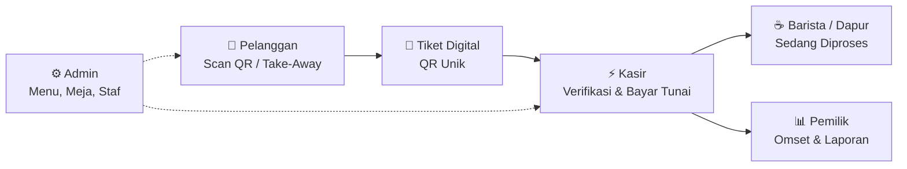

**Sistem Informasi & Platform Manajemen Kafe Terintegrasi**  
*Solusi digital modern yang menghubungkan pemesanan mandiri pelanggan, operasional kasir pintar, hingga laporan analitik bisnis.*

[Tentang](#-tentang-aplikasi) · [Fitur](#-fitur-utama--modul-sistem) · [Desain](#-karakteristik-desain--pengalaman-pengguna) · [Arsitektur](#️-keunggulan-arsitektur-sistem) · [Tim](#-tim-pengembang)

---

### 📍 Profil Kafe
**ABS Cafe (Accessories & Cafe)**  
Jl. Letjend Suprapto No.44, Kepatihan, Kec. Tulungagung, Kabupaten Tulungagung, Jawa Timur 66219  
📞 **Kontak / WhatsApp:** 0896-2010-2010  
⏰ **Jam Operasional:** Setiap Hari, 09.00 - 23.00 WIB (*Last Order: 22.00 WIB*)

---

## 🌟 Tentang Aplikasi

**ABS Cafe Web Platform** adalah ekosistem digital berbasis web yang dirancang khusus untuk meningkatkan efisiensi operasional kafe, memangkas antrean, dan memberikan pengalaman bersantap yang berkesan bagi pelanggan. 

Aplikasi ini mengintegrasikan seluruh lini bisnis kafe ke dalam satu sistem terpusat:
- 🧑‍🤝‍🧑 **Pelanggan:** Memesan langsung dari meja melalui scan QR atau memilih menu take-away secara mandiri.
- 💵 **Kasir:** Memproses transaksi cepat, melayani pembayaran tunai, mencetak struk, dan memverifikasi pesanan tanpa hambatan pergantian shift.
- 📈 **Manajemen & Pemilik:** Mengontrol ketersediaan menu secara *real-time* serta memantau performa penjualan secara akurat.

### 🔁 Alur Singkat Sistem

> [!NOTE]
> Desain antarmuka mengusung konsep **Warm Coffee Shop Aesthetic** dengan perpaduan warna coklat espresso, karamel emas, dan latar krem yang elegan, memberikan kenyamanan visual baik di layar smartphone pelanggan maupun monitor POS kasir.

<a href="#top">⬆️ Kembali ke atas</a>

## 🚀 Fitur Utama & Modul Sistem

### 1. 📱 Portal Pelanggan (Customer Web Experience)
*Didesain responsif (*mobile-first*) untuk kemudahan akses langsung di smartphone pelanggan tanpa perlu mengunduh aplikasi.*

  

- 🏆 **Top 3 Menu Terfavorit Otomatis (Real-Time Daily Update):**
  - Menampilkan 3 menu paling populer setiap hari yang dihitung otomatis dari total penjualan nyata (`sold_count`). Tidak ada rekayasa input manual, sehingga rekomendasi menu selalu mencerminkan selera pelanggan terkini.
- 🪑 **Pemesanan QR Meja (Dine-In) & Antar Meja:**
  - Pelanggan cukup memindai kode QR yang ada di meja untuk membuka menu, memilih varian, menambahkan catatan khusus, dan mengirim pesanan langsung ke sistem kafe.
- 🥡 **Pemesanan Take-Away:**
  - Opsi pesanan bawa pulang dengan estimasi waktu dan ringkasan pesanan yang jelas.
- 📅 **Sistem Reservasi Meja Online:**
  - Pelanggan dapat memesan tempat lebih awal dengan memilih tanggal, jam kedatangan, jumlah orang, preferensi area meja (*Indoor, Outdoor, Lantai 2*), serta catatan acara.
- 🎫 **Tiket Pesanan Digital & QR Pembayaran:**
  - Setelah mengirim pesanan, pelanggan mendapatkan tiket digital dengan kode QR unik untuk ditunjukkan ke kasir saat proses verifikasi dan pembayaran tunai.

☕ &nbsp;·&nbsp; ☕ &nbsp;·&nbsp; ☕

### 2. ⚡ Portal Kasir (Smart Point of Sale & Shift Management)
*Antarmuka kasir yang tanggap, cepat, dan siap menangani antrean jam sibuk.*

  

- 🔄 **Pergantian Kasir Fleksibel Tanpa Logout:**
  - Shift operasional kasir berjalan otomatis terus-menerus di latar belakang (*continuous shift*).
  - Ketika terjadi pergantian jam kerja, petugas kasir cukup memilih nama staf yang bertugas dari menu dropdown di bilah navigasi tanpa perlu keluar masuk (*logout-login*) akun.
  - Nama kasir yang bertugas akan otomatis tercetak pada struk pembayaran dan riwayat audit pesanan.
- 🧾 **Kasir Cepat (POS) & Verifikasi Scan Tiket:**
  - Layar kasir mendukung input manual langsung untuk pelanggan yang memesan langsung di kasir.
  - Dilengkapi fitur kamera scan QR untuk memvalidasi tiket pelanggan dan langsung memperbarui status ke tim barista/dapur (*Sedang Diproses*).
- 💰 **Pembayaran Tunai (Cash Only) & Kalkulator Kembalian:**
  - Menghitung total transaksi, nominal uang yang diterima, dan nilai kembalian secara presisi.
- 🖨️ **Pencetakan Struk Nota Termal:**
  - Terintegrasi dengan printer termal standar (58mm/80mm) dengan tata letak nota yang rapi dan mencantumkan rincian pajak PB1 serta pesan penutup kafe.
- 🗄️ **Pencatatan Kas Laci (Cash In & Cash Out):**
  - Modul pencatatan modal awal dan pengeluaran kas kecil operasional yang langsung tersinkronisasi ke laporan rekap kasir.

☕ &nbsp;·&nbsp; ☕ &nbsp;·&nbsp; ☕

### 3. 📊 Portal Pemilik (Owner & Executive Analytics)
*Pusat kendali visual untuk pemilik kafe dalam mengambil keputusan bisnis berbasis data.*

  

- 💹 **Dashboard Omset Real-Time:**
  - Ringkasan pendapatan kotor (*Gross Revenue*), jumlah pesanan harian, rata-rata nominal transaksi (*Average Order Value*), dan tingkat keterisian meja.
- 📉 **Grafik Tren & Penjualan Kategori:**
  - Visualisasi grafik interaktif tren penjualan harian, mingguan, serta perbandingan kategori produk terlaris (*Coffee vs Non-Coffee vs Makanan*).
- 🗂️ **Laporan & Riwayat Transaksi Lengkap:**
  - Arsip seluruh data transaksi yang dapat difilter berdasarkan rentang tanggal, status pesanan, serta kasir yang bertugas, dengan fitur ekspor data.

☕ &nbsp;·&nbsp; ☕ &nbsp;·&nbsp; ☕

### 4. ⚙️ Portal Administrator (Manajemen Bisnis & Katalog)
*Pengaturan menyeluruh untuk menjamin kelancaran operasional harian.*

  

- 🍰 **Manajemen Katalog Menu & Varian:**
  - Pengelolaan daftar menu makanan dan minuman, harga, foto produk, serta switch ketersediaan stok (*Tersedia / Habis*).
  - Dilengkapi proteksi **Soft-Delete**: menu yang dinonaktifkan atau dihapus tidak akan merusak data laporan keuangan transaksi lampau.
- 🏷️ **Manajemen Kategori & Denah Meja:**
  - Pengaturan urutan kategori menu dan denah nomor meja kafe lengkap dengan unduhan gambar QR Code meja otomatis siap cetak.
- 👥 **Manajemen Staf & Peran:**
  - Pengaturan akun staf operasional, status keaktifan, dan pembagian hak akses sistem.
- 🧩 **Pengaturan Profil & Format Struk:**
  - Kustomisasi teks header/footer nota struk belanja, persentase pajak restoran (PB1), dan informasi kontak kafe.
- 🔐 **Log Audit Keamanan:**
  - Rekaman jejak aktivitas sistem yang mencatat setiap tindakan penting staf untuk menjaga transparansi dan akuntabilitas.

<a href="#top">⬆️ Kembali ke atas</a>

## 🎨 Karakteristik Desain & Pengalaman Pengguna

- 🟤 **Warm Coffee Shop Palette:** Nuansa visual yang hangat dan profesional menggunakan kombinasi warna coklat tua pekat, aksen karamel emas, dan latar belakang krem lembut yang mencerminkan estetika kafe modern.
- 🔤 **Tipografi Berkarakter:** Perpaduan gaya huruf *Noto Serif* untuk judul kafe yang elegan dan *Poppins* untuk kenyamanan membaca data pesanan dan angka harga.
- 📲 **Responsif & Ringan:** Antarmuka otomatis menyesuaikan tampilan ponsel layar sentuh (pelanggan & kasir tablet) maupun layar monitor desktop (komputer kasir & kantor).

<a href="#top">⬆️ Kembali ke atas</a>

---

## 🛡️ Keunggulan Arsitektur Sistem

1. 🔒 **Keamanan Transaksi & Integritas Data:**  
   Setiap transaksi terhubung dengan audit trail yang mencatat tanggal, jam, status pembayaran, dan identitas staf yang bertanggung jawab.
2. 🏠 **Kemandirian Operasional:**  
   Sistem tetap dapat mencatat pesanan kasir dengan cepat tanpa bergantung pada koneksi internet eksternal saat berjalan di jaringan lokal kafe.
3. 🌱 **Skalabilitas Bisnis:**  
   Struktur database terstandarisasi yang siap dikembangkan jika kafe menambah cabang atau memperluas area layanan meja di masa mendatang.

---

### 👥 Tim Pengembang
Dikembangkan oleh **Fanverse Team**  
*(XI RPL 1 — SMKN 1 Boyolangu)*

---

© 2026 **ABS Cafe (Accessories & Cafe), Tulungagung**  
*Menciptakan Pengalaman Bersantap yang Lebih Mudah, Cepat, dan Menyenangkan.*

 

