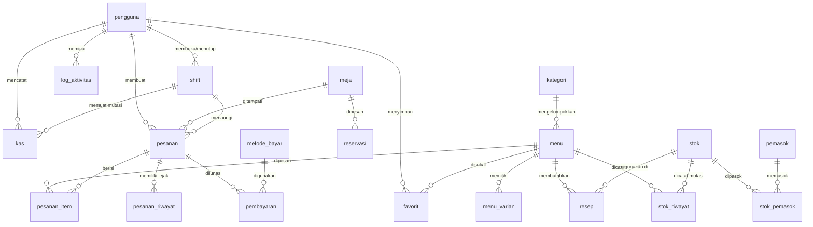

# Dokumentasi Skema Database ABS Cafe

Dokumen ini memuat arsitektur database baru ABS Cafe hasil penyederhanaan dan peleburan tabel tumpang tindih, dengan penamaan Bahasa Indonesia ringkas berbasis snake_case tanpa kehilangan satu pun data.

---

## 1. Ikhtisar & Ringkasan Perubahan

- **Jumlah tabel sebelum penyederhanaan**: 32 tabel (24 tabel aplikasi + 8 tabel peran/izin/sistem).
- **Jumlah tabel setelah penyederhanaan**: 28 tabel (27 tabel aplikasi + 1 tabel framework `migrations`).
- **Nama kolom**: Tidak ada kolom yang diubah namanya pada tabel yang dipertahankan.
- **Tabel yang dilebur**:
  1. `tables` (10 baris aktif) + `cafe_tables` (0 baris, usang) $\rightarrow$ **`meja`**
  2. `cash_movements` (0 baris) + `cash_adjustments` (0 baris) $\rightarrow$ **`kas`** (dengan kolom pembeda `type`: `masuk`, `keluar`, `penyesuaian`)
  3. `stock_logs` (18 baris menu) + `stock_movements` (0 baris bahan baku) $\rightarrow$ **`stok_riwayat`** (dengan kolom pembeda `type`: `masuk`, `keluar`, `koreksi`)
  4. `cafe_settings` (28 baris aktif) + `settings` (0 baris, usang) $\rightarrow$ **`pengaturan`** (dengan kolom tambahan opsional `group`)
- **Tabel pembayaran**: `payments` (1.032 baris) $\rightarrow$ **`pembayaran`**. Relasi 1-to-many tetap fleksibel untuk transaksi di masa mendatang.

---

## 2. Pemetaan Tabel Lama ke Tabel Baru

| No | Tabel Lama | Baris Data | Tabel Baru | Keterangan & Peleburan |
|---|---|---|---|---|
| 1 | `users` | 7 | `pengguna` | Akun staf, kasir, admin, dan owner |
| 2 | `categories` | 14 | `kategori` | Kategori produk kafe |
| 3 | `menus` | 142 | `menu` | Master item menu & katalog |
| 4 | `menu_variants` | 152 | `menu_varian` | Opsi varian ukuran/suhu/rasa menu |
| 5 | `favorites` | 0 | `favorit` | Menu favorit pengguna |
| 6 | `tables` | 10 | `meja` | Peleburan `tables` + `cafe_tables` (kolom `area`, `notes`) |
| 7 | `cafe_tables` | 0 | `meja` | Dilebur ke `meja` |
| 8 | `payment_methods` | 5 | `metode_bayar` | Master metode pembayaran (tunai, qris, debit, dll.) |
| 9 | `promos` | 3 | `promo` | Diskon & promo diskon menu / voucher |
| 10 | `cafe_settings` | 28 | `pengaturan` | Peleburan `cafe_settings` + `settings` (kolom `group`) |
| 11 | `settings` | 0 | `pengaturan` | Dilebur ke `pengaturan` |
| 12 | `stocks` | 0 | `stok` | Master persediaan bahan baku |
| 13 | `suppliers` | 0 | `pemasok` | Vendor / mitra pemasok bahan |
| 14 | `stock_supplier` | 0 | `stok_pemasok` | Pivot relasi persediaan bahan dan pemasok |
| 15 | `recipes` | 0 | `resep` | Komposisi bahan per menu/varian |
| 16 | `cash_shifts` | 163 | `shift` | Sesi kerja dan pembukuan laci kasir |
| 17 | `cash_movements` | 0 | `kas` | Peleburan arus kas masuk/keluar & penyesuaian |
| 18 | `cash_adjustments` | 0 | `kas` | Dilebur ke `kas` (`type = penyesuaian`) |
| 19 | `stock_logs` | 18 | `stok_riwayat` | Peleburan mutasi stok produk & bahan baku |
| 20 | `stock_movements` | 0 | `stok_riwayat` | Dilebur ke `stok_riwayat` |
| 21 | `orders` | 1.058 | `pesanan` | Transaksi pesanan offline & web |
| 22 | `order_items` | 2.585 | `pesanan_item` | Rincian baris item pesanan |
| 23 | `order_timelines` | 3.192 | `pesanan_riwayat` | Jejak status pemrosesan pesanan |
| 24 | `payments` | 1.032 | `pembayaran` | Transaksi pembayaran |
| 25 | `reservations` | 4 | `reservasi` | Reservasi meja pelanggan |
| 26 | `activity_logs` | 117 | `log_aktivitas` | Audit log aktivitas staf/pengguna |
| 27 | `roles` | 0 | `peran` | Hak peran Spatie Permission |
| 28 | `permissions` | 0 | `izin` | Hak akses Spatie Permission |
| 29 | `role_has_permissions` | 0 | `peran_izin` | Pivot peran dan izin |
| 30 | `model_has_roles` | 0 | `pengguna_peran` | Pivot penugasan peran ke pengguna |
| 31 | `model_has_permissions` | 0 | `pengguna_izin` | Pivot penugasan izin langsung ke pengguna |
| 32 | `migrations` | 14 | `migrations` | Tabel framework pelacak status migrasi |

---

## 3. Detail Kolom Kunci dan Tabel Peleburan

### A. Tabel `kas` (Peleburan `cash_movements` + `cash_adjustments`)
Tabel ini mencatat seluruh mutasi kas laci kasir serta penyesuaian kas fisik oleh Owner/Admin.

- **`id`** (`bigint unsigned`, Primary Key)
- **`shift_id`** (`bigint unsigned`, Foreign Key ke `shift.id`, nullable): Berisi ID shift terkait. Bernilai `null` jika penyesuaian kas dibuat saat tidak ada shift aktif atau sebelum shift berikutnya dibuka.
- **`user_id`** (`bigint unsigned`, Foreign Key ke `pengguna.id`): Pembuat mutasi/penyesuaian.
- **`type`** (`enum('masuk', 'keluar', 'penyesuaian')`):
  - `masuk`: Kas masuk non-penjualan (misal: tambah modal laci).
  - `keluar`: Kas keluar operasional (misal: beli es batu, bayar sampah).
  - `penyesuaian`: Penyesuaian selisih fisik laci oleh Owner/Admin.
- **`amount`** (`decimal(12,2)`): Nominal uang (positif/negatif jika penyesuaian).
- **`reason`** (`text`): Alasan atau keterangan transaksi kas.
- **`created_at`, `updated_at`** (`timestamp`)

### B. Tabel `stok_riwayat` (Peleburan `stock_logs` + `stock_movements`)
Tabel ini menyatukan pencatatan mutasi sisa porsi menu siap saji dan pengurangan/penambahan bahan baku.

- **`id`** (`bigint unsigned`, Primary Key)
- **`menu_id`** (`bigint unsigned`, Foreign Key ke `menu.id`, nullable)
- **`stock_id`** (`bigint unsigned`, Foreign Key ke `stok.id`, nullable)
- **`user_id`** (`bigint unsigned`, Foreign Key ke `pengguna.id`, nullable)
- **`type`** (`varchar(30)`): Nilai valid: `masuk`, `keluar`, `koreksi`.
- **`quantity`** (`int` / `decimal(10,2)`): Jumlah unit yang bertambah/berkurang.
- **`stock_before`** (`int`, nullable)
- **`stock_after`** (`int`, nullable)
- **`item_name`** (`varchar(255)`, nullable)
- **`notes`** (`text`, nullable)
- **`actor`** (`varchar(100)`, nullable)
- **`created_at`, `updated_at`** (`timestamp`)

### C. Tabel `meja` (Peleburan `tables` + `cafe_tables`)
- **`id`** (`bigint unsigned`, Primary Key)
- **`number`** (`int`, Unique): Nomor meja.
- **`capacity`** (`int`): Kapasitas kursi.
- **`status`** (`enum('tersedia','terpakai','nonaktif')`): Ketersediaan meja.
- **`location_notes`** (`varchar(255)`, nullable): Catatan lokasi (misal: Lantai 2, Dekat Jendela).
- **`area`** (`varchar(50)`, nullable): Area kafe (indoor, outdoor, smoking).
- **`notes`** (`text`, nullable): Catatan tambahan.

### D. Tabel `pengaturan` (Peleburan `cafe_settings` + `settings`)
- **`id`** (`bigint unsigned`, Primary Key)
- **`key`** (`varchar(100)`, Unique): Kunci konfigurasi.
- **`value`** (`longtext`, nullable): Nilai konfigurasi.
- **`type`** (`varchar(30)`): Tipe data (`text`, `boolean`, `integer`, `json`, dll.).
- **`group`** (`varchar(50)`): Kategori pengaturan (`general`, `finance`, `order`, dll.).

---

## 4. Diagram Relasi Entitas (ERD)



---

## 5. Prosedur Pembersihan Tabel Arsip (`db:hapus-arsip`)

Selama proses migrasi, tabel-tabel lama diubah namanya menjadi `arsip_<nama_tabel_lama>` agar tidak ada risiko kehilangan data.

Setelah sistem berjalan normal dan diverifikasi, tabel arsip dapat dihapus secara permanen menggunakan perintah Artisan:

```bash
# Menjalankan dengan konfirmasi interaktif:
php artisan db:hapus-arsip

# Menjalankan langsung tanpa konfirmasi (misal pada pipeline otomatis):
php artisan db:hapus-arsip --force
```

Perintah ini akan melakukan pengecekan kesehatan terlebih dahulu:
- Memastikan tabel baru (`pengguna`, `menu`, `pesanan`, dll.) dalam keadaan ada dan sehat.
- Menghapus hanya tabel-tabel dengan awalan `arsip_`.

---

## 6. Prosedur Rollback (Migrasi Down)

Jika diperlukan pembatalan migrasi secara penuh dan kembali ke skema lama:

```bash
php artisan migrate:rollback --step=1
```

Fungsi `down()` pada file migrasi `2026_10_24_210000_sederhanakan_dan_lebur_tabel_database.php` dirancang simetris dan aman:
1. Memvalidasi ketersediaan tabel arsip (`arsip_*`).
2. Menghapus tabel-tabel baru.
3. Mengembalikan nama seluruh tabel `arsip_*` ke nama tabel aslinya (`users`, `menus`, `orders`, `cash_movements`, dll.).
4. Mengembalikan seluruh indeks dan foreign key ke konfigurasi awal.
